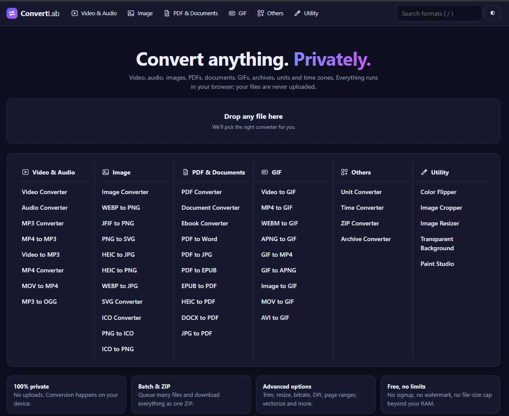

# ConvertLab

ConvertLab is a private, in-browser file converter and small creative toolkit. Video, audio, images, PDFs, documents, GIFs, archives, units, time zones and a paint editor all run on your own device. **Files are never uploaded to a server.**

It is plain HTML, CSS and JavaScript. There is no build step, no framework and no backend.

---

## Images


<br>
<br>
<br>

## Contents

1. [Quick start](#1-quick-start)
2. [Project structure](#2-project-structure)
3. [The interface](#3-the-interface)
4. [Video & Audio](#4-video--audio)
5. [Image](#5-image)
6. [PDF & Documents](#6-pdf--documents)
7. [GIF](#7-gif)
8. [Others](#8-others)
9. [Utility](#9-utility)
10. [Paint Studio in depth](#10-paint-studio-in-depth)
11. [Third-party libraries and the network](#11-third-party-libraries-and-the-network)
12. [How the code is organised](#12-how-the-code-is-organised)
13. [Adding or changing a tool](#13-adding-or-changing-a-tool)
14. [Limits and troubleshooting](#14-limits-and-troubleshooting)
15. [Browser support and privacy](#15-browser-support-and-privacy)

---

## 1. The interface

### Header
- **Logo**: returns to the home page.
- **Category buttons**: Video & Audio, Image, PDF & Documents, GIF, Others, Utility. Hover (desktop) or click (touch) to open the **mega menu**, which lists every tool in every category, six columns wide on a large screen.
- **Search box**: type a format or tool name (for example `heic`, `ico`, `zip`) and pick a result. Press **`/`** anywhere to focus it, **Enter** to open the first match, **Esc** to close.
- **Theme button**: toggles light and dark mode. The choice is remembered in the browser.

### Home page
- A large drop zone. **Drop any file** and ConvertLab opens the most suitable converter for it (for example a `.heic` file opens HEIC to JPG, a `.pdf` opens PDF Converter, a `.zip` opens Archive Converter).
- The full tool menu is repeated on the page.
- Four short feature cards: privacy, batch processing, advanced options, no limits.

### Converter pages
Every converter (everything in Video & Audio, Image, PDF & Documents, GIF, plus Archive Converter) shares one page layout.

| Area | What it does |
|---|---|
| **Drop zone** | Drop files, click to browse, or paste an image from the clipboard. Unsupported extensions are skipped with a message. |
| **Queue** | One card per file with a thumbnail (for images), size, an **output format selector**, live status and a progress bar. Each file can use its own output format. |
| **Remove (✕)** | Removes a file from the queue (not while it is converting). |
| **Ready to download panel** | After conversion, a highlighted panel appears directly above the action bar. It lists every output file with its size and its own **Download** button. When several input images are merged into one PDF or GIF, there is a single row for the merged file. |
| **Action bar** | **Convert** (or *Convert N files*), **Cancel** (while running), **Download all** (bundles every result into one ZIP, or downloads directly if there is just one file), **Clear**, and a short summary such as "5 files - 3 done". |
| **Preview** | A single converted image, audio or video file is previewed inside its queue card. |
| **Convert again / Retry** | Re-run a finished file, or retry a failed one. |
| **Options panel (right)** | **Convert to** and a set of options. Only options that make sense for the current files and output format are shown. |
| **Related tools** | Quick links to other tools in the same category. |

Status messages include the time taken and the size change, for example "Done in 1.2s - 340 KB (-35%)".

### Batch behaviour
- Files are converted one after another.
- Choosing **Combine all images into one file** (shown when several images are queued and the output is PDF or GIF) merges them into a single PDF or GIF.
- Multi-file results (for example every page of a PDF as an image, or every size inside an ICO) appear as separate rows in the download panel and can all be saved with **Download all**.

---

## 2. Video & Audio

**Tools:** Video Converter, Audio Converter, MP3 Converter, MP4 to MP3, Video to MP3, MP4 Converter, MOV to MP4, MP3 to OGG.

### How it works
- **WAV and MP3 output from audio files** is handled natively in the browser: the file is decoded with the Web Audio API, processed, and MP3 is encoded with the *lamejs* library. This is fast and needs no big download.
- **Everything else** (all video, plus audio formats other than WAV/MP3) uses **ffmpeg.wasm**, a WebAssembly build of FFmpeg. The engine is about 30 MB and is downloaded once, then cached by the browser.
- If native audio decoding fails for a file, ConvertLab automatically falls back to ffmpeg.

### Formats
- **Video in:** mp4, m4v, mov, avi, mkv, webm, flv, wmv, mpg, mpeg, 3gp, ogv, ts.
- **Audio in:** mp3, wav, ogg, oga, opus, m4a, aac, flac, wma, aiff, amr, weba, mka.
- **Video out (Video Converter):** mp4, webm, mkv, mov, avi, flv, wmv, gif, and audio-only mp3, wav, ogg, m4a, flac.
- **Audio out (Audio Converter):** mp3, wav, ogg, opus, m4a, aac, flac, aiff, wma.

### Options
| Option | Applies to | Notes |
|---|---|---|
| **Trim: start / length** | video and audio | Seconds or `mm:ss`. Leave length empty for the whole file. |
| **Resolution** | video out | Original, 1080p, 720p, 480p, 360p, 240p (never upscales). |
| **Video quality** | video out | High, Medium, Low (small file), Tiny. |
| **Frame rate** | video out | Original, 60, 30, 24, 15. |
| **Remove audio** | video out | Strips the soundtrack. |
| **Audio bitrate** | audio out, video soundtrack | 64 to 320 kbps. |
| **Sample rate** | audio out | Original, 48 kHz, 44.1 kHz, 22 kHz, 16 kHz. |
| **Channels** | audio out | Original, mono, stereo. |
| **Volume** | audio out | 10% to 300%. |

### Notes
- Video encoding in WebAssembly is slower than a desktop app. Long or high-resolution files can take a while; **Cancel** stops the job.
- Video uses H.264/AAC for MP4/MKV/MOV, VP8/Vorbis for WEBM, and MPEG-4, FLV1 or WMV2 for AVI, FLV and WMV.

---

## 3. Image

**Tools:** Image Converter, WEBP to PNG, JFIF to PNG, PNG to SVG, HEIC to JPG, HEIC to PNG, WEBP to JPG, SVG Converter, **ICO Converter**, **PNG to ICO**, **ICO to PNG**.

### Formats
- **In:** jpg/jpeg/jfif, png, webp, gif (first frame), bmp, avif, ico, svg, heic/heif.
- **Out:** png, jpg, webp, bmp, ico, svg, gif, pdf.
- HEIC/HEIF files are decoded with the *heic2any* library.
- Animated GIFs are read as their first frame here; use the GIF category for animation.

### Options
| Option | Notes |
|---|---|
| **Quality** | For JPG, WEBP and image-to-PDF. |
| **Max width / height** | Shrinks images that are larger, keeping proportions. |
| **Rotate / Flip** | 90°, 180°, 270°; horizontal or vertical flip. |
| **Grayscale** | Converts to black and white. |
| **Background colour** | Used when the output has no transparency (JPG, BMP, PDF). |
| **SVG render scale** | 1x to 4x, when rasterising an SVG file. |
| **SVG mode** | When converting a raster image **to SVG**: *Vectorize* (posterised colour shapes) or *Embed* the raster image inside an SVG wrapper. |
| **Colours / Trace resolution** | Controls the quality and size of vectorised SVG. Best for logos and icons. |
| **ICO size** | 16, 32, 48, 64, 128, 256 px, or *All sizes* in one `.ico` file. |
| **ICO input: sizes to extract** | *Largest size only* or *Every size* as separate files named like `icon-32x32.png`. |
| **Combine into one file** | Several images into one PDF. |
| **Page size / orientation / margin** | For image-to-PDF: A4, Letter or fit-to-image. |

### ICO support in detail
- **Reading ICO:** a built-in decoder handles both modern PNG-compressed icons and older BMP-style icons (1, 4, 8, 24 and 32-bit with transparency masks). It picks the largest image, or extracts all of them.
- **Writing ICO:** icons are written with PNG-compressed images, which Windows, browsers and favicon tools accept. Non-square images are centred inside a square.
- **ICO Converter** converts in both directions: ICO to any image type and any image type to ICO.
- **PNG to ICO** and **ICO to PNG** are the same engine with a simpler preset.

### Vectorising (PNG to SVG)
The tracer reduces the image to a limited palette using median-cut colour quantisation, then converts runs of same-colour pixels into merged rectangles per colour. It produces a clean, editable SVG for flat artwork. It is **not** a photographic tracer, so photos will look posterised.

---

## 4. PDF & Documents

**Tools:** PDF Converter, Document Converter, Ebook Converter, PDF to Word, PDF to JPG, PDF to EPUB, EPUB to PDF, HEIC to PDF, DOCX to PDF, JPG to PDF.

### Conversion pipeline
Most document conversions go through one shared pipeline:

1. **Read** the input into an internal document tree:
   - **DOCX**: via *mammoth* (headings, paragraphs, lists, tables, images).
   - **TXT**: paragraphs split on blank lines.
   - **Markdown**: a built-in parser (headings, bold, italic, code, links, images, lists, quotes, tables, rules).
   - **HTML**: parsed and sanitised (scripts, styles, forms and event handlers removed).
   - **RTF**: converted to plain text.
   - **EPUB**: chapters read in reading order with their images embedded.
   - **PDF**: text read page by page with *pdf.js*, rebuilt into paragraphs and headings by font size and line spacing.
2. **Write** the output from that tree:
   - **PDF**: ConvertLab's own layout engine on top of *jsPDF* (headings, paragraphs, bullet and numbered lists, nested lists, tables, code blocks, quotes, rules, images, clickable links, page numbers).
   - **DOCX**: built with the *docx* library.
   - **EPUB**: a valid EPUB 3 package (with an EPUB 2 table of contents for older readers) split into chapters.
   - **TXT / Markdown / HTML**: generated directly.

### PDF to image
**PDF to JPG** (and PDF Converter with an image output) renders each page with pdf.js to JPG, PNG or WEBP. One file is created per page, named `name-page-01.jpg`, and all can be downloaded as one ZIP.

### Options
| Option | Notes |
|---|---|
| **Pages** | For PDF input. `All`, or a list like `1-3,5,8-`. |
| **Render resolution** | 72 to 300 dpi for PDF to image. |
| **PDF to Word mode** | *Editable text* or *Page images* (use this for scanned PDFs). |
| **Paper size, font, font size, margin** | For anything that outputs PDF (Document, EPUB, DOCX and TXT to PDF). |
| **Title / Author** | Metadata written into PDF, DOCX and EPUB. |
| **Image options** | For JPG to PDF and HEIC to PDF: quality, page size, orientation, margin, combine into one PDF. |

### Notes
- Conversions focus on **content**, not pixel-perfect layout. Complex Word layouts, text boxes and exact fonts are simplified.
- **Scanned PDFs** have no selectable text, so PDF to Word or PDF to EPUB will report that. Use *Page images* mode, or convert pages to JPG.
- Text containing characters outside the standard Latin set (for example Hindi, Chinese or emoji) is rendered as small images inside the PDF so it still appears correctly, but that text will not be selectable.
- **MOBI and AZW3** are not supported in the browser.
- Password-protected PDFs are rejected with a clear message.

---

## 5. GIF

**Tools:** Video to GIF, MP4 to GIF, WEBM to GIF, MOV to GIF, AVI to GIF, APNG to GIF, GIF to MP4, GIF to APNG, Image to GIF.

### How it works
- **Video to GIF** (and the MP4/WEBM/MOV/AVI variants): the browser plays the video, captures frames at your chosen frame rate onto a canvas, and a **built-in GIF encoder** (median-cut palette, LZW compression, looping) writes the file. No extra download is needed. If the browser cannot decode the video, ConvertLab falls back to ffmpeg.wasm automatically.
- **Image to GIF**: turns one image, or many images, into a GIF slideshow with a frame delay you choose. Images of different sizes are fitted onto the first image's canvas.
- **GIF to MP4, GIF to APNG, APNG to GIF**: use ffmpeg.wasm.

### Options
| Option | Notes |
|---|---|
| **GIF frame rate** | 5, 8, 10, 12, 15, 20 fps. |
| **GIF width** | Original, 240, 320, 480, 640, 800 px. |
| **Looping** | Loop forever or play once. |
| **Trim: start / length** | Pick the part of the video to convert. |
| **Frame delay (ms)** | For Image to GIF. |
| **Combine all images** | One GIF from many images. |

GIFs are limited to 256 colours per file, so file sizes and quality are a balance of frame rate, width and length. Video to GIF captures at most 400 frames to keep memory use reasonable.

---

## 6. Others

### Unit Converter
Fourteen categories, each with a live "from / to" converter, a **Swap** button, **Copy result**, and a table showing the value in **every** unit of that category:

Length, Mass, Temperature, Volume, Area, Speed, Time, Data (decimal and binary, e.g. MB and MiB), Energy, Power, Pressure, Angle, Frequency, Fuel economy.

Temperature and fuel economy use proper formulas (for example L/100km is inverse to km/L) rather than simple ratios.

### Time Converter
Three tabs:

- **Time zones**: pick a date and time in any zone, and see the equivalent in a list of target zones with date, time, UTC offset and a "+1 day" hint. Add or remove zones; "Now" resets to the current time. Daylight saving is handled by the browser's time-zone database.
- **Unix timestamp**: shows the live current timestamp. Paste seconds, milliseconds or an ISO date to see Unix seconds, milliseconds, ISO 8601, UTC, local time and a relative description such as "in 3 days". Every row has a **Copy** button.
- **Duration**: type `1d 2h 30m`, `3725` (seconds) or `01:02:05` and see it in HH:MM:SS, milliseconds, seconds, minutes, hours, days, weeks and years.

### Archive Converter
Converts between **ZIP**, **TAR** and **TAR.GZ** (also reads `.gz`). It reads the original archive, then repacks every file into the new format. ZIP output has a compression-level option. Long file names and sub-folders are preserved.

### ZIP Converter
Makes a ZIP from **a whole folder or many files** of any type (PDFs, images, text and so on).

- **Choose folder** or **Choose files**, or **drag a folder** (or many files) onto the page. Sub-folders are kept.
- A scrollable list shows every file with its path and size, with a ✕ to remove individual files, and a total count and size.
- **Options:** ZIP file name (it defaults to the folder's name), compression (store, fast, normal, maximum), *Keep folder structure* (turn off to flatten everything into one level, duplicate names are renamed automatically), and *Skip junk files* (`.DS_Store`, `Thumbs.db`, `desktop.ini`, `__MACOSX`).
- A progress bar runs during compression. The finished ZIP appears in the **Ready to download** panel with its size and how much smaller it is than the originals.
- Everything stays on your device, so very large folders depend on available memory.

---

## 7. Utility

The **Utility** tab contains five image tools. The four simple ones share one workflow: **drop or paste an image, adjust, then download**. Every tool has an export panel with **Save as** (PNG, JPG, WEBP, BMP, ICO, GIF, SVG, PDF), quality, background colour for formats without transparency, ICO size, and file name. **Copy to clipboard** copies the result as a PNG.

### Color Flipper
Colour and orientation changes with a live preview.

- **Quick effects:** Invert, Grayscale, Sepia, Vintage, Cool, Warm, B&W, Posterize, Swap R/B, Negative.
- **Sliders:** invert amount, hue rotate (0-360°), saturation, brightness, contrast, grayscale amount, sepia amount, posterise levels, black/white threshold.
- **Swap colour channels:** RGB, RBG, GRB, GBR, BRG, BGR.
- **Replace a colour:** choose a source colour, a target colour and a tolerance.
- **Geometry:** rotate 90/180/270° and flip horizontally or vertically.
- Previews use a reduced-size copy for speed; the download is processed at full resolution.

### Image Cropper
- Drag on the image to draw a new crop box, drag the box to move it, drag the **eight handles** to resize. A rule-of-thirds grid is shown inside the box.
- **Aspect ratio:** Free, Original, 1:1, 4:3, 3:2, 16:9, 21:9, 3:4, 2:3, 9:16, or a custom ratio. The box stays locked to the ratio while you resize.
- **Crop shape:** rectangle, or **ellipse / circle** (corners become transparent, so export as PNG, WEBP or ICO).
- **Exact numbers:** X, Y, Width and Height fields stay in sync with the box.
- Quick buttons: Select all, Rotate left/right, Flip H/V (these change the source image before cropping).

### Image Resizer
- **Width and height** in pixels with **Lock aspect ratio**.
- **Scale presets** (10% to 300%) and **longest-side presets** (16 to 3840 px, handy for icons and thumbnails).
- **When both sizes are set:** stretch to exact size, *fit inside* (adds padding in a colour you choose, or transparent), or *fill and crop*.
- **Resampling:** *Smooth* uses stepwise down-scaling for much better quality when shrinking a lot, or *Sharp pixels* uses nearest-neighbour for pixel art.
- The panel shows "old size → new size (percent)".

### Transparent Background
Removes a background colour and gives you an image with transparency.

- The key colour is detected from the top-left pixel automatically. **Click anywhere on the image** to pick a different colour to remove.
- **Tolerance** controls how similar a colour must be, and **Edge softness** feathers the edge for a smoother cut.
- **Remove:** *Background only* (only areas connected to the image edges, so a similar colour inside the subject is kept) or *This colour everywhere*.
- Export to PNG, WEBP, GIF or ICO to keep the transparency.

### Paint Studio
A full drawing editor. It is described in detail in the next section.

---

## 8. Paint Studio in depth

Paint Studio opens with a transparent 800 × 600 canvas, shown on a checkerboard (turn **Show transparency** off to see plain white).

### Layout
- **Left:** tool palette (Draw, Shapes, Tools).
- **Centre:** top toolbar, the canvas viewport, and a status line showing canvas size, zoom, cursor position, selection size and hints.
- **Right:** Colors, Tool options, Selection, Image, Export.

### Toolbar
**New**, **Open image**, **Import onto canvas**, **Undo**, **Redo**, zoom − / +, **Fit**, **100%**, **Grid**, a workspace background picker (grey, white, black, dark), **Show transparency** and **Download**.

### Colours
- Two colour slots: **primary** (left click) and **secondary** (right click). Click a swatch to choose which slot you are editing. **Swap** exchanges them.
- A colour picker, a **hex** field (accepts `#rgb` or `#rrggbb`), and a **colour opacity** slider where 0% is fully transparent.
- A palette of 20 colours plus a **transparent** swatch. Left-click sets the active slot; right-click a swatch sets the secondary colour.
- A **Recent** list of your last colours.
- A **Screen picker** button on browsers that support the EyeDropper API, to sample any colour on screen.
- The **Eyedropper** tool samples from the canvas, including its transparency.

### Draw tools
| Tool | Behaviour |
|---|---|
| **Pen** | Smooth freehand line with adjustable smoothing. |
| **Pencil** | Hard-edged, pixel-aligned line with no anti-aliasing, good for pixel art. |
| **Soft brush** | Airbrush-style dabs with adjustable hardness. |
| **Marker** | Wide, semi-transparent strokes. |
| **Spray** | Random spray dots that keep spraying while you hold still. |
| **Eraser** | Erases to real transparency. Opacity controls how much it removes. |

Common options: **size**, **opacity**, **hardness** (soft brush), **smoothing** (pen, marker, eraser, soft brush), and **symmetry**: off, horizontal, vertical, both axes, or radial ×3, ×4, ×6, ×8, so everything you draw is mirrored live. **Pen pressure** is supported with a stylus. Strokes are composited as one layer, so overlapping parts of a single stroke never darken.

### Shapes
Line, Arrow, Rectangle, Rounded, Ellipse, Triangle, Right triangle, Diamond, Polygon, Star, Heart, Cross and Block arrow.

- **Style:** outline (primary colour), filled (primary colour), or outline in primary plus fill in secondary.
- **Line style:** solid, dashed, dotted. **Stroke width** uses the size slider.
- **Sides / points:** for Polygon and Star (3 to 16). **Corner radius:** for Rounded.
- While dragging: **Shift** makes a perfect square or circle (or snaps lines to 45°), **Alt** draws from the centre.

#### Editable shapes (move, scale, rotate)
After you draw a shape it stays **live** instead of being stamped onto the canvas:

- **Move:** drag inside the shape.
- **Scale:** drag the square handles on corners and edges. **Shift** keeps proportions, **Alt** scales from the centre. Edges follow the shape's rotation.
- **Rotate:** drag the round handle above the shape. **Shift** snaps to 15° steps.
- **Lines and arrows:** drag either endpoint (Shift snaps to 45°).
- **Arrow keys** nudge the shape by 1 px (10 px with Shift).
- Changing **colour, size, fill style, dash, sides or radius** updates the live shape immediately.
- The shape is **applied** to the canvas when you press **Enter**, double-click, click outside it, choose another tool, export, or press **Apply shape / float**. **Delete** discards it. **Undo** after applying removes the whole shape in one step.
- To draw a second shape that overlaps the live one, press Enter first (a drag that starts inside a live shape moves it).

### Other tools
- **Fill bucket:** scanline flood fill with **tolerance** and a **contiguous / everywhere** switch. Colours with partial opacity blend over existing pixels.
- **Gradient:** drag to set direction. **Linear or radial**, from primary to secondary or from primary to transparent, honouring the opacity setting and any selection.
- **Text:** click, type, press Enter. Font family, size, bold and italic options.
- **Select:** rectangular selection. Drag inside it to lift and move the pixels; move or resize with the corner handles; double-click or Enter to apply.
- **Magic erase:** click a colour to turn it transparent (with tolerance, contiguous or global). Useful for removing backgrounds.
- **Hand / pan:** drag to scroll the canvas. You can also hold **Space**, or use the middle mouse button.

### Selection panel
Select all, Deselect, Copy, Cut, Paste, Delete, **Crop to selection**, and **Apply shape / float**. Copy also puts a PNG on the system clipboard where the browser allows it.

### Image panel
- **Transform:** rotate left/right/180°, flip horizontal/vertical.
- **Resize image…** (scales the picture with smooth resampling) and **Canvas size…** (crops or extends the canvas, with a nine-point anchor).
- **Filters:** Invert, Grayscale, Sepia, Brighter, Darker, Blur, Pixelate.
- **Transparency helpers:** *Fg colour → transparent* (uses the tolerance slider), *Fill transparent with secondary colour*, *Trim transparent edges*, *Clear canvas*.

### New canvas, import and export
- **New** lets you set width and height (presets from 16×16 icons to 1920×1080) and a background: transparent, white, primary or secondary colour.
- **Open image** replaces the canvas with an image (undoable). **Import onto canvas** places an image as a floating layer you can move and scale before applying. **Dropping** or **pasting** an image also places it.
- **Export** to **PNG, JPG, WEBP, BMP, ICO, GIF, SVG (embedded) or PDF**, with quality, background colour (for formats without transparency), ICO size (single or all sizes) and file name. **Trim transparent edges** crops to the drawing before export. **Copy PNG** puts the image on the clipboard.

### Navigation and input
- **Zoom:** Ctrl/Cmd + mouse wheel (zooms around the cursor), toolbar buttons, `+` / `-` keys, `0` to fit. Above 300% pixels render sharp for pixel-art work. **Grid** shows a pixel grid at high zoom.
- **Touch:** draw with one finger, **pinch with two fingers to zoom and pan**.
- **Stylus:** pressure changes stroke size.
- **History:** unlimited-feeling undo/redo (up to 60 steps, fewer for very large canvases to protect memory).

### Keyboard shortcuts
| Key | Action |
|---|---|
| B / P / E | Pen / Pencil / Eraser |
| G / I / T | Fill / Eyedropper / Text |
| L / A / R / O / S | Line / Arrow / Rectangle / Ellipse / Star |
| M / W / H | Select / Magic erase / Hand |
| X | Swap primary and secondary colours |
| [ and ] | Smaller / larger brush |
| + / − / 0 | Zoom in / zoom out / fit |
| Space (hold) | Pan |
| Ctrl/Cmd + Z, Ctrl/Cmd + Y (or Shift+Z) | Undo, Redo |
| Ctrl/Cmd + C, X, V, A | Copy, Cut, Paste, Select all |
| Enter | Apply the live shape or floating selection |
| Esc | Apply a live shape, cancel a floating selection, or deselect |
| Delete / Backspace | Delete the live shape or selection contents |
| Arrow keys | Nudge a live shape (Shift = 10 px) |

---

## 9. Third-party libraries and the network

ConvertLab bundles **no** third-party code. Libraries are loaded on demand, only when a tool needs them, then cached by the browser.

| Library | Used for | Source |
|---|---|---|
| JSZip 3.10.1 | ZIP creation and reading, EPUB packaging, multi-file downloads | cdnjs / jsDelivr |
| jsPDF 2.5.1 | Writing PDF files | cdnjs / jsDelivr |
| pdf.js 3.11.174 | Reading and rendering PDFs | cdnjs / jsDelivr |
| mammoth 1.6.0 | Reading DOCX | cdnjs / jsDelivr |
| docx 8.5.0 | Writing DOCX | jsDelivr / unpkg |
| lamejs 1.2.1 | MP3 encoding | cdnjs / jsDelivr |
| heic2any 0.0.4 | Decoding HEIC/HEIF photos | jsDelivr / unpkg |
| ffmpeg.wasm 0.12 (core 0.12.6) | Video and most audio/GIF conversion | jsDelivr / unpkg |

Each library has a backup mirror. If the first CDN fails or times out, the next is tried.

**Works with no internet at all:** Unit Converter, Time Converter, image conversion between PNG/JPG/WEBP/BMP/ICO/SVG, Paint Studio (except PDF export), Color Flipper, Cropper, Resizer, Transparent Background (except PDF export), Video to GIF and Image to GIF.

To make ConvertLab fully offline, download the libraries above into a folder (for example `js/vendor/`) and change the URLs in `js/libs.js`.

---

## 10. How the code is organised

### State and routing
- The app is a single page with hash routing: `#/paint-studio`, `#/jpg-to-pdf` and so on. `router()` in `ui.js` reads the hash, looks the tool up in the `TOOLS` array, and calls the right page renderer.
- Converter tools are described entirely by data (see below) and use `renderTool()`. Tools with their own page carry a `view` field (`unit`, `time`, `zip`, `flip`, `crop`, `resize`, `bgrm`, `paint`) that maps to a dedicated renderer.
- A global `state` object holds the current converter's queue, options and running state. Pages that need cleanup (paint shortcuts, listeners) set a `cleanup` function that the router calls when you leave.

### Tool catalogue (`data.js`)
Each converter is one entry created with `T(id, category, name, description, config)`:

```js
T('mov-to-mp4', 'media', 'MOV to MP4', 'Convert QuickTime MOV videos to MP4.',
  { ins: ['mov'], outs: ['mp4', 'webm', 'gif', 'mp3'], def: 'mp4' })
```

- `ins` lists accepted input extensions, `outs` lists output formats, `def` is the default.
- `route(inputExt, outputExt)` decides which **engine** performs a conversion: `image`, `img2pdf`, `img2gif`, `audio`, `video`, `anim`, `vid2gif`, `pdf2img`, `document` or `archive`.
- `OPTS` is the list of option definitions. Each has a `show(context)` function, so options appear only when relevant to the files and output formats currently chosen.

### Engines
`ENGINES` (defined at the end of `document-engine.js`) maps an engine name to an async function `(job, options, io) => results`. `io` provides `progress(fraction, message)` and `check()` (which throws if the user pressed Cancel). Each result is `{ name, blob }`.

### Queue and results (`ui.js`, `zip-tool.js`)
`runAll()` groups queued files into jobs (merging images when asked), runs each engine, stores results on the file's queue item, and calls `refreshUI()`, which redraws the **Ready to download** panel through `renderResults()`.

### Editors (`editors.js`)
`renderEditor(tool, config)` is a reusable page for single-image tools. A config supplies `defaults()`, `controls()`, `apply(canvas, options)` and optional `preview`, `pick`, `onLoad`. Color Flipper, Resizer and Transparent Background are each a short config object. The cropper has its own renderer because of its interactive overlay. `exportPanel()` and `exportCanvas()` provide the shared save-as formats.

### Paint Studio (`paint.js`)
One large function, `renderPaint()`, owns all state in a single object `P`. Drawing uses two canvases stacked on top of each other: `#pmain` holds committed pixels and `#pov` is a transparent overlay for in-progress strokes, shape previews, selections, handles, the grid and the brush cursor. Freehand strokes are drawn onto a hidden stroke layer and composited once at the end, which gives uniform opacity. History stores `ImageData` snapshots.

---

## 11. Adding or changing a tool

### Add a simple converter
1. Open `js/data.js`.
2. Add a line to the `TOOLS` array:
   ```js
   T('avi-to-mp4', 'media', 'AVI to MP4', 'Convert AVI videos to MP4.',
     { ins: ['avi'], outs: ['mp4', 'webm'], def: 'mp4' }),
   ```
3. Make sure `route()` knows how to handle that input/output pair. For common media, images and documents it already does.
4. The tool appears in the menu, the search box and the home page automatically.

### Add a new option
Add an entry to `OPTS` in `data.js` with a key `k`, label `l`, control type `t` (`range`, `select`, `check`, `number`, `text`, `color`), a default `def`, and a `show(context)` function. Read the value from the `o` argument inside your engine.

### Add a new category
Add an entry to `CATS` in `data.js` and an icon to `IC` in `icons.js`, then use the new id as the category in your `T(...)` calls.

### Add a custom page tool
Give the tool a `view` name in `data.js`, write a `renderYourTool(tool)` function (see `renderZip` in `zip-tool.js` for a compact example), and register it in the `V` map inside `router()` in `ui.js`.

### Change the look
Colours, spacing and dark mode are CSS variables at the top of `css/style.css` (`--accent`, `--bg`, `--card`, `--line` and others). The dark theme overrides them under `html[data-theme=dark]`.

---

## 12. Limits and troubleshooting

| Symptom | Likely cause and fix |
|---|---|
| "Couldn't load the … component" | The CDN was unreachable. Check your internet connection and retry. |
| Video/audio tools say the engine could not start | Open the site through a local server (`python3 -m http.server`) instead of directly from disk, and use Chrome or Edge. |
| Video conversion is slow or stalls | WebAssembly encoding is slower than desktop FFmpeg. Try a lower resolution or frame rate, or trim the clip. Very large files need a lot of RAM. |
| "This browser cannot encode WebP" | Use Chrome, Edge or Firefox. |
| PDF to Word reports no selectable text | The PDF is scanned. Use *Page images* mode, or convert pages to JPG. |
| Non-English text in a PDF cannot be selected | Characters outside the basic Latin set are drawn as images so they display correctly. |
| HEIC fails to decode | Some unusual HEIC variants are not supported by the decoder. Try exporting the photo as JPG from its original device. |
| Large image cannot be processed | The browser limits canvas size. Reduce the maximum width/height option. Paint Studio refuses new canvases above 64 million pixels. |
| Merged images look different sizes in a GIF | All frames are fitted to the first image's dimensions. |
| MOBI / AZW3 files | Not supported in the browser. Convert them to EPUB with a desktop tool first. |
| Clipboard copy does nothing | Some browsers only allow clipboard image writes on secure (`https` or `localhost`) pages. |

**Size guidance:** everything is held in memory, so the practical limit is your device's RAM rather than a fixed file-size cap.

---

## 13. Browser support and privacy

- **Best experience:** current Chrome or Edge. Firefox works for most features. Safari works for many features but has limits (for example canvas filters used by the Blur effect, and WebP encoding on older versions).
- **Privacy:** all conversion happens locally in your browser tab. The only network requests are the one-time downloads of the libraries listed in [section 11](#11-third-party-libraries-and-the-network). Your files, drawings and settings are not sent anywhere. The only thing stored in the browser is your light/dark theme choice.
- **No accounts, no watermark, no tracking.**

## Download App
- **Click the link to download :**<br>'<https://example.com>
- **Website link :**<br><https://example.com>